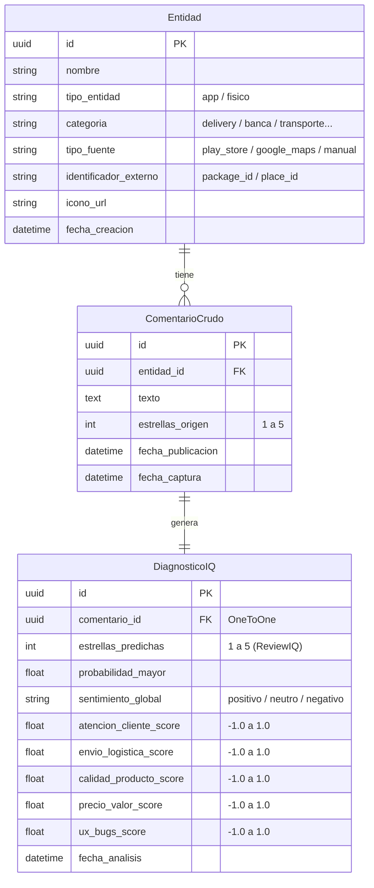

# Plan Técnico de Backend: Módulo de Diagnóstico y Reputación

> Documento de diseño y arquitectura para la extensión comercial de **ReviewIQ**.  
> **Fecha:** 26 de octubre de 2026  
> **Estado:** Aprobado para implementación  

---

## 1. Objetivo y Alcance

Este módulo extiende el motor de predicción de estrellas de ReviewIQ para construir un **Portal de Diagnóstico de Reputación Comercial**.  
A partir de reseñas públicas (iniciando con **Google Play Store** y extensible a negocios físicos), el sistema:
1. Almacena las entidades, las reseñas originales y la fecha de publicación en PostgreSQL.
2. Procesa cada reseña mediante el modelo multiclase de ReviewIQ (estrellas 1 a 5 con vector de 5 probabilidades).
3. Aplica un motor léxico de análisis de tópicos para clasificar el impacto en **5 Dimensiones de Experiencia**:
   * Atención al Cliente
   * Envío / Logística
   * Calidad del Producto o Servicio
   * Relación Precio / Valor
   * Experiencia Digital / Fallos de la App (UX)
4. Expone endpoints REST para alimentar el **Semáforo de Experiencia** y el comparador **Versus** en el frontend.

---

## 2. Arquitectura de Datos (PostgreSQL)

### Reglas de Integridad
* `UniqueConstraint(tipo_fuente, identificador_externo)`: impide duplicar la misma entidad en una misma plataforma.
* `OneToOneField(ComentarioCrudo, DiagnosticoIQ)`: asegura que cada comentario posea un único diagnóstico calculado.

---

## 3. Motor Lingüístico de Dimensiones (`dimensions.py`)

Como el modelo base de ReviewIQ fue entrenado sobre el corpus de Amazon con etiquetas globales de 1–5 estrellas, las 5 dimensiones operativas se extraen mediante **detección de tópicos por léxico curado en español**, combinada con la inferencia de estrellas del modelo:

1. **Normalización del texto:** Se reutiliza `normalize_text` de `ml/nlp/normalize.py` para minúsculas y eliminación de caracteres no léxicos.
2. **Detección de presencia:** Si el texto normalizado contiene palabras clave de una dimensión, dicha dimensión se activa para esa reseña.
3. **Puntuación por dimensión ($s \in [-1.0, 1.0]$):**
   * Estrellas 1–2 (Negativo): $s = -1.0 \times (P(1) + P(2))$
   * Estrella 3 (Neutro): $s = 0.0$
   * Estrellas 4–5 (Positivo): $s = +1.0 \times (P(4) + P(5))$
   * Si la dimensión no se menciona en la reseña: $s = 0.0$ (no computa para el promedio de esa dimensión).

### Cálculo del Semáforo Global (0% a 100%)
Para una entidad con $N$ menciones en una dimensión $d$:
$$\text{Score}_d = \left( \frac{\sum s_{d, i}}{N} + 1 \right) \times 50$$
* 🟢 **Verde (Saludable):** $\text{Score} \ge 75\%$
* 🟡 **Amarillo (Regular / Atención):** $45\% \le \text{Score} < 75\%$
* 🔴 **Rojo (Crítico / Problema recurrente):** $\text{Score} < 45\%$

---

## 4. Contratos de la API REST (`/api/v1/reputation/`)

| Método y Ruta | Descripción | Parámetros / Cuerpo |
|---|---|---|
| `GET /api/v1/reputation/entities/` | Catálogo de entidades registradas con filtros | `?categoria=...&tipo=...&search=...` |
| `GET /api/v1/reputation/entities/{id}/diagnostic/` | Diagnóstico completo: estrellas promedio, distribución y semáforo 5D | Ruta `{id}` |
| `GET /api/v1/reputation/entities/{id}/reviews/` | Comentarios crudos con sus estrellas predichas y dimensiones | Ruta `{id}`, paginado `?limit=20` |
| `GET /api/v1/reputation/versus/?e1={id}&e2={id}` | Comparador lado a lado entre dos entidades | Query params `e1` y `e2` |
| `POST /api/v1/reputation/sync/playstore/` | Ingesta desde Google Play Store y predicción en lote con ReviewIQ | `{"package_id": "...", "categoria": "...", "nombre": "...", "count": 50}` |

---

## 5. Plan de Ejecución por Pasos

1. **Paso 1 (Completado):** Modelos ORM y migraciones aplicadas en PostgreSQL (`reviewiq.0001_initial`).
2. **Paso 2:** Motor de dimensiones y cálculo del semáforo en `backend/apps/reviewiq/dimensions.py`.
3. **Paso 3:** Módulo de extracción de Google Play Store en `backend/apps/reviewiq/scraper.py`.
4. **Paso 4:** Vistas de la API REST en `backend/apps/reviewiq/views.py`.
5. **Paso 5:** Serializadores y registro de rutas en `backend/api/serializers.py` y `backend/api/urls.py`.
6. **Paso 6:** Pruebas automatizadas en `tests/test_reputation.py`.
